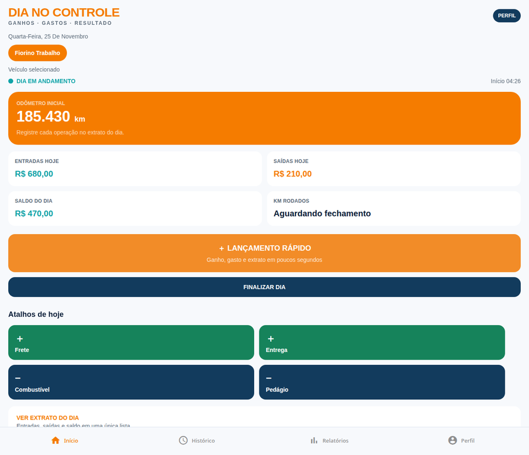
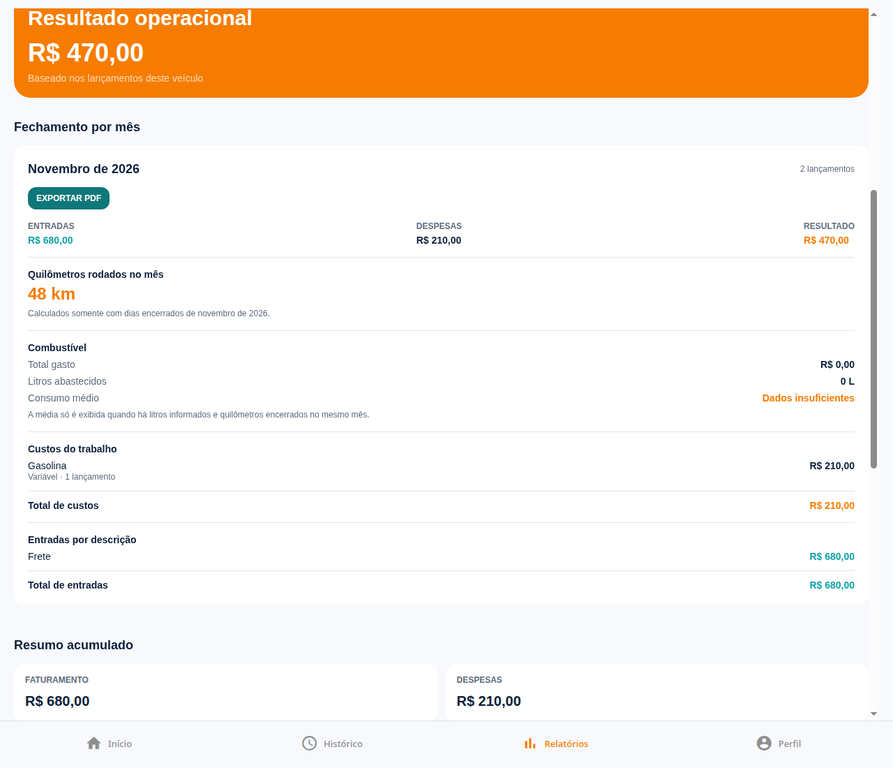
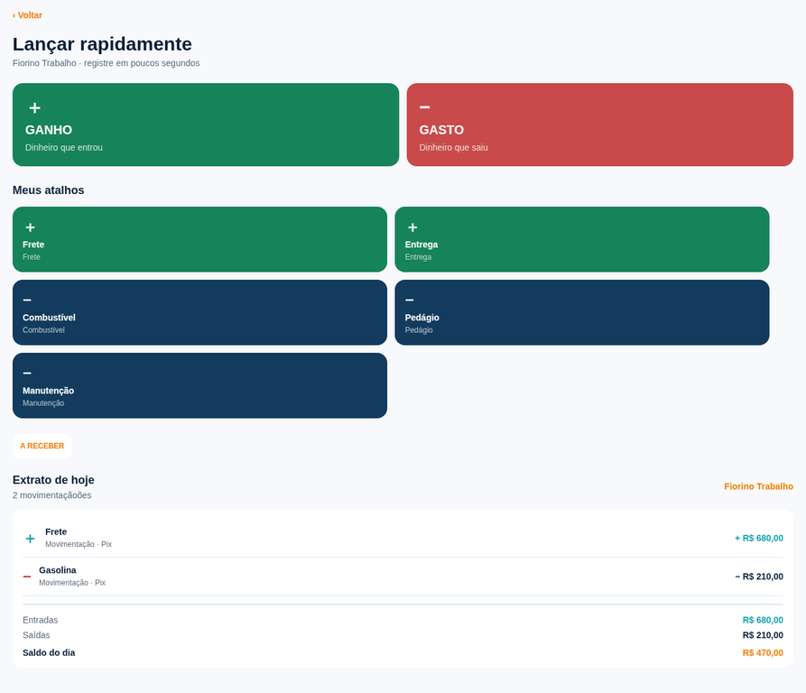

## 📱 Conheça o aplicativo

## 📲 Baixe o aplicativo

Quer experimentar o Dia no Controle?

[⬇️ BAIXAR O DIA NO CONTROLE](https://drive.google.com/file/d/1s4lO7jhU9eEqlYTjbt61tUl6lK_zn9Do/view?usp=drivesdk)

**Organize seu trabalho. Controle seus resultados.**
# 🚀 Dia no Controle

### Organize seu trabalho. Controle seus resultados.

O Dia no Controle é um aplicativo desenvolvido para profissionais autônomos que desejam ter mais organização e controle sobre sua rotina de trabalho.

Chega de depender de anotações em papel ou cálculos espalhados. Tenha seus ganhos, gastos e informações operacionais organizados em um só lugar.

## 🎯 Para quem é?

- Motoboys e entregadores
- Motoristas de aplicativo
- Motoristas autônomos
- Profissionais de transporte
- Trabalhadores que utilizam veículos para trabalhar

## ⚙️ Principais funcionalidades

- Registro de ganhos
- Controle de despesas
- Acompanhamento de quilômetros rodados
- Controle de combustível
- Acompanhamento dos resultados financeiros

## 💡 Nosso objetivo

Ajudar profissionais autônomos a entender melhor seus resultados, organizar suas finanças e ter mais controle sobre o próprio trabalho.

---

**Dia no Controle — Seu trabalho, seus números, seu controle.**
